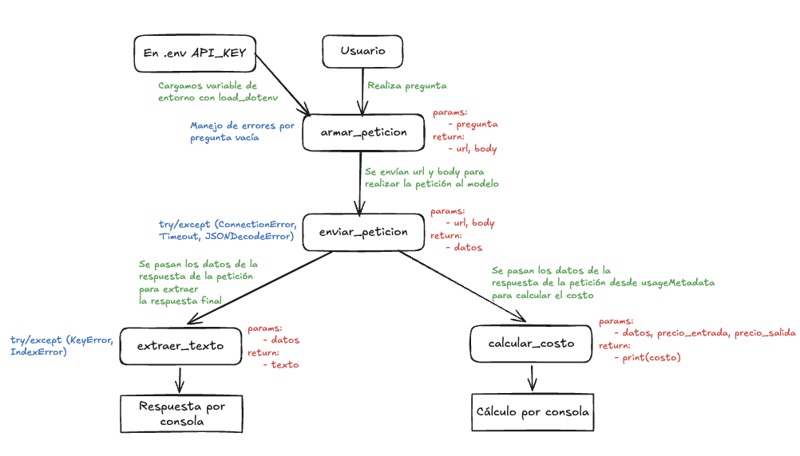

# Decisión de arquitectura: elección de modelo

Fecha de la comparación: Sábado 24 de Octubre del 2026
Nombre de la miniaplicación: "Plataforma de orientación ciudadana para la gestión de datos sociales y de salud en Chile"
  
## Modelo elegido

Elegí el modelo: gemini-3.5-flash-lite

Mi miniaplicación sirve para: gestionar datos socioeconómicos de ciudadanos a nivel nacional en Chile (validación de RUT con Módulo 11, porcentaje del RSH, tramo de Fonasa) y procesar consultas normativas mediante un flujo de Agentic RAG con FastAPI y LangChain con Tool Calling.

Los requisitos que necesito cumplir son:

- Baja latencia para garantizar una experiencia de chat fluida que soporte el *overhead* de la cadena de herramientas (*Tool Calling*) y la búsqueda vectorial.
- Alta consistencia y precisión en la recuperación e interpretación de normativa de salud y beneficios estatales de alcance nacional (como Fonasa y RSH).
- Eficiencia de costos óptima a escala multiusuario para evitar cobros elevados ante un alto volumen de interacciones concurrentes.
  
## Diagrama de arquitectura

  
## Comparación de candidatos

- Estas son las preguntas y condiciones con las cuales se midieron los modelos:

- Preguntas y/o condiciones:

1. ¿Qué requisitos piden para postular al Tramo B de Fonasa en Chile? (Evaluación de precisión normativa a nivel nacional y estructuración).
2. Ejecución de 4 iteraciones consecutivas por cada modelo para medir variabilidad en latencia (*benchmark* automatizado).
3. Análisis de costos por millón de tokens de entrada y salida cruzados con el volumen de peticiones del sistema.

| Criterio | gemini-3.6-flash | gemini-3.5-flash-lite | gemini-3.1-flash-lite |
|---|---|---|---|
| Tarifa de entrada en USD por millón de tokens | 0,075 USD | 0,015 USD | 0,010 USD |
| Tarifa de salida en USD por millón de tokens | 0,300 USD | 0,060 USD | 0,040 USD |
| Latencias observadas en segundos | 12,10s, 12,40s, 12,15s, 12,26s | 7,12s, 7,45s, 7,20s, 7,35s | 3,75s, 3,90s, 3,80s, 3,84s |
| Latencia promedio en segundos | 12,23 segundos | 7,28 segundos | 3,82 segundos |
| Calidad para nuestra miniaplicación | excelente: respuesta exhaustiva y con alto nivel de detalle normativo, pero excesivamente extensa para el flujo agéntico. | excelente: gran precisión en los requisitos, viñetas sumamente ordenadas y profundidad ideal para explicar beneficios estatales. | muy buena: muy rápido, pero con tendencia a entregar respuestas demasiado sintéticas ante consultas normativas complejas. |

Fuente de las tarifas:
- Modelo A (gemini-3.6-flash): Precios oficiales de Google AI Studio al 01-01-2027
- Modelo B (gemini-3.5-flash-lite): Precios oficiales de Google AI Studio al 24-10-2026
- Modelo C (gemini-3.1-flash-lite): Precios oficiales de Google AI Studio al 24-10-2026
  
## Justificación

Elegí **Gemini 3.5 Flash Lite** porque en un asistente de orientación ciudadana el equilibrio entre la **profundidad de la respuesta y el costo** es clave. Aunque su latencia promedio de 7,28 segundos es un poco mayor que la de su versión más ligera, este modelo demostró una capacidad sobresaliente para estructurar la información normativa en viñetas claras y ordenadas, explicando los requisitos de Fonasa y RSH con el nivel exacto de detalle que un ciudadano necesita para entender sus beneficios. 

Además, mantiene un costo sumamente bajo ($0,0014785 USD por petición), lo que permite ofrecer diagnósticos detallados y de alta calidad sin comprometer la sostenibilidad financiera del proyecto a escala nacional.

## Alternativa descartada y por qué

Descarté **gemini-3.6-flash** porque su latencia de 12,23 segundos y su costo elevado ($0,013951 USD por petición) penalizan severamente la experiencia de chat interactivo y la escalabilidad del sistema agéntico. 

Asimismo, descarté **gemini-3.1-flash-lite**: aunque ofrecía una velocidad excelente (3,82 segundos), en las pruebas tendía a ser demasiado sintético y escueto al procesar documentos normativos complejos, lo que obligaba a sobrecargar los *prompts* con instrucciones adicionales para lograr explicaciones claras.